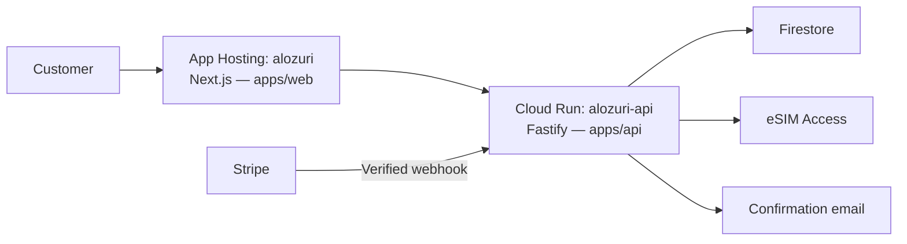

# Alozuri deployment targets

Alozuri currently runs two managed application services in the same Firebase/Google Cloud project. Both source trees live in the same GitHub repository. They have independent builds, deployments and production revisions.

| Target                                          | Source                           | Runtime and responsibility                                                                                                                                                  | How a release reaches it                                                     |
| ----------------------------------------------- | -------------------------------- | --------------------------------------------------------------------------------------------------------------------------------------------------------------------------- | ---------------------------------------------------------------------------- |
| Firebase App Hosting backend `alozuri`          | `apps/web`                       | Next.js pages, browser UI, server rendering and approved same-origin API proxy routes                                                                                       | Manual App Hosting rollout of a GitHub commit                                |
| Cloud Run service `alozuri-api`, `europe-west4` | `apps/api` and `packages/shared` | Fastify commerce API, authoritative prices, private orders, Stripe webhooks, supplier fulfilment, scheduled worker, confirmation email and requested contract PDF downloads | Build the root API Dockerfile and deploy the resulting image to this service |

Firebase calls its website deployment an App Hosting **backend**. That product label refers to the Next.js website runtime. It does not mean the separate `alozuri-api` service is included in that rollout. App Hosting itself manages server infrastructure for Next.js, so the website is not merely static files.

`npm run build` checks/builds both workspaces locally. It does not publish either service. A Git push updates source control. A manual App Hosting rollout publishes the website. The API requires its own image build and Cloud Run deployment.

Before queue activation, the minute scheduler invoked `/internal/fulfillment/run` on the API with its configured OIDC service identity. This is a worker endpoint in the same API application, not a third application deployment. Downloadable PDFs are generated in memory by that API on request; they introduce no new service or PDF storage.

For a coordinated production release, record the intended commit, relevant targets, configuration checks and migrations first. Publish both targets when a feature spans them, then verify the App Hosting build/traffic and API image/revision separately. Report which revision is live for each target. Never infer that an API/email change is live from a successful website rollout alone.

At the inspection on 12 November 2026, GitHub `main` and website production were on `e7939d12a25717367297555e04ed697c2d907983`. App Hosting build `build-2026-11-12-001` was serving 100% of traffic. The API remained on `alozuri-api-00011-sc7`, last updated 11 November at 23:51 UTC. These are inspection results, not a deployment performed by this document.

## Payment-triggered queue

[Payment-triggered order processing](order-processing.md) uses a Cloud Tasks queue in `europe-west1` to invoke a targeted worker in the existing `alozuri-api` service in `europe-west4`. It adds no application service or Firebase Function. The production activation on 12 November 2026 sets `ORDER_PROCESSING_MODE=queue` and pauses the minute fulfilment schedule; daily catalogue refresh remains separate. New purchases receive their complete confirmation email only after every QR profile is saved. Queue mode is an API deployment/configuration change, not part of a website-only App Hosting rollout.

## Coordinated manual release workflow

[The manual Release production action](releases.md) adds one entry point for both existing services. It selects changed services against their live commits, stages/checks the API, rolls out the website from the same selected commit and reports both results. A Git push still runs checks only. The Firebase console Rollout button remains website-only. Deployment IAM/environment configuration must be approved before enabling this workflow; no cloud identity or production rollout was created during preparation.
