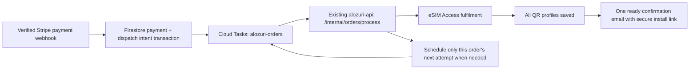

# Payment-triggered order processing

Production activation was requested by the owner on 12 November 2026. The release switches the existing API to `ORDER_PROCESSING_MODE=queue`, uses `alozuri-orders` in `europe-west1`, and pauses the minute fulfilment scheduler. The code still defaults to `scheduler` when configuration is absent, so future deployments must preserve the production queue settings. See the activation evidence at the end of this document.

## Architecture



The worker runs in the existing API service. No additional Cloud Run service, Cloud Run Job, Firebase Function, Firestore trigger, extension or PDF storage is introduced. Firebase task queue functions also use Cloud Tasks, but would add a function deployment here. Existing Next.js and API deployments remain separate; only the API needs this queue feature. App Hosting rollout alone cannot activate it.

The verified webhook commits the paid purchase, immutable per-eSIM order records, existing fulfilment records and an `orderWork/{id}` dispatch intent atomically. It then submits a named task containing only `{kind, id, generation}` and acknowledges Stripe after submission succeeds. Email and supplier calls do not run in the webhook. An enqueue failure returns HTTP 503; Stripe replays the webhook. A seen Stripe event still repairs its pending dispatch intent. No client success-page request authorises this work.

The worker targets that purchase only. New purchases use `email-v2-ready`: supplier preparation starts after verified payment and a validated immutable legal snapshot, and the complete confirmation email is sent only after every purchased unit is ready with validated private activation details saved. The secure installation link therefore opens an already prepared order. Per the owner’s requested flow, the previous email-before-supply gate applies only to existing `email-v1` purchases; their payloads, delivery gates and send-idempotency keys are retained. Payments first confirmed after this release also upgrade previously opened checkouts to `email-v2-ready`; already-paid orders retain their recorded confirmation version. The new email uses a versioned idempotency key and includes the recorded contract. No QR credentials are included in email content. Delivery checks and supplier allocation waits schedule targeted future tasks at their recorded due times. They return HTTP 200 after the successor task is durably submitted, so normal waiting does not throttle the whole queue. Technical failures return HTTP 503 and use Cloud Tasks retries.

Each successor increments the durable generation before submission. If submission fails, retrying the previous task repairs the new pending generation before acknowledging it. Old generations cannot process an order again. Named task deduplication, a worker lease, existing transactional eSIM claims, stable supplier transaction IDs and email-provider idempotency remain in force. Test payments do not create live tasks. Failed/unverified payments cannot supply an eSIM.

Work is bounded to 24 hours from its initial dispatch intent; the next invocation then marks it `attention`, acknowledges the task and leaves the order, provider references and retry records available for investigation. It does not silently purchase again, resend an uncertain email or issue a new refund. Provider send uncertainty retains the existing 23-hour idempotency guard. This deadline is a support boundary, not a delivery promise.

## Resources and cost for approval

One Cloud Tasks queue in `europe-west1` (Cloud Tasks does not support the API’s `europe-west4` region), one dedicated OIDC caller service account and narrowly scoped IAM grants are proposed. Queue settings are in [order-queue.json](../infra/order-queue.json): one dispatch/second, two concurrent tasks, technical retries from 15 seconds to five minutes, capped at 300 attempts per task. These limits control throughput; they are not a monetary cap. The application's 24-hour work deadline bounds order processing when the worker is reachable. During a complete worker outage, the queue stops at its attempt limit; the durable intent remains for explicit recovery.

Cloud Tasks includes the first 1 million monthly operations, then US$0.40 per additional million. Creation, each delivery attempt and management API calls count as operations; large payloads are charged in 32 KiB chunks. The allowance is shared by billing account. Existing Cloud Run, Firestore, networking, build and logging charges still apply. No zero-cost guarantee is made. There are no queue calls or database scans when the queue is empty. [Cloud Tasks pricing](https://cloud.google.com/tasks/pricing), [HTTP task authentication](https://docs.cloud.google.com/tasks/docs/creating-http-target-tasks).

The existing `alozuri-fulfillment` Scheduler job is retained paused after cutover. Catalogue refresh schedules, if any, are unrelated and must be retained. Do not delete the old job during the initial migration; it supports rollback.

## Production configuration

Keep existing secret bindings and API resource limits. Add the following only at approved activation:

```yaml
ORDER_PROCESSING_MODE: queue
ORDER_TASK_QUEUE: projects/alozuri/locations/europe-west1/queues/alozuri-orders
ORDER_TASK_WORKER_URL: https://alozuri-api-rnm3hsyqia-ez.a.run.app/internal/orders/process
ORDER_TASK_AUDIENCE: https://alozuri-api-rnm3hsyqia-ez.a.run.app
ORDER_TASK_SERVICE_ACCOUNT: alozuri-order-worker@alozuri.iam.gserviceaccount.com
```

Missing/invalid queue configuration fails startup rather than silently accepting paid orders without dispatch. The queue and OIDC caller must belong to `GOOGLE_CLOUD_PROJECT`. The audience is the existing service origin, not the route path. The endpoint verifies a Google-signed token, audience, verified email and exact dedicated service-account email; caller-supplied Cloud Tasks headers are not authentication. Strict bodies reject customer data, supplier secrets or arbitrary task actions. Existing Firestore deny-by-default rules protect dispatch records; no browser access is added.

After approval, enable the Cloud Tasks API and create the queue with the rates/retries in `infra/order-queue.json`. Create it empty, then pause it before deploying queue mode. Queue `state` is output-only on create; use the pause operation, not a `state` field in the JSON. Required IAM:

- API runtime service account: `roles/cloudtasks.enqueuer` on this queue only.
- API runtime service account: `roles/iam.serviceAccountUser` on the dedicated task caller account only, for task OIDC configuration.
- Task caller account: `roles/run.invoker` on the existing `alozuri-api` service. It needs no database, secret or queue-management privileges.
- Cloud Tasks service agent: its standard `roles/cloudtasks.serviceAgent` role must be present so Google can mint task identity tokens. Do not distribute JSON keys or grant Owner/Editor.
- The migration operator needs database access, enqueue permission on this queue and permission to use the caller identity. Use Application Default Credentials; do not copy runtime secrets into source control.

See [Cloud Tasks authentication](https://docs.cloud.google.com/tasks/docs/authentication) and [queue-scoped access](https://docs.cloud.google.com/tasks/docs/secure-queue-configuration).

## Approved cutover procedure

These are review instructions, not operations already performed:

1. Record the release commit, current API revision/configuration and scheduler state. Complete the tests below. Resolve existing confirmation-provider requirements: the Resend key must support send and delivery-status retrieval; disable automatic successful-payment Stripe receipt emails if the single-email policy is intended. Verify the current Stripe webhook configuration.
2. Create/configure the empty queue, caller identity and IAM, then pause the queue. Keep its existing Cloud Run CPU/memory/minimum-instance settings. Do not create another server or turn on minimum instances.
3. Pause checkout using the existing `CHECKOUT_PAUSED=true` control and allow active worker requests to finish. Deploy the API from the recorded commit with the approved queue settings. Keep the queue paused while checking the revision, health, webhook route and unauthorised worker rejection. Do not split API traffic between scheduler and queue revisions during cutover.
4. Inventory and submit existing work using the migration tool below. It includes future email/supplier retries and legacy standalone orders, not just work due now. Existing payment evidence, legal snapshots, email idempotency state, supplier order numbers and activation credentials are preserved. With the queue paused, tasks can be submitted without making supplier purchases.
5. Resume the queue, verify the authenticated delivery in a controlled non-live environment first, then observe the migrated production work. After queue delivery is confirmed, pause `alozuri-fulfillment`. In queue mode the old endpoint returns 410 instead of scanning orders, so leaving the scheduler active must be detected and corrected. Verify pending work is queued or explicitly marked for review; reopen checkout only after that check.

Do not submit a live test payment, trigger supplier issuance or activate infrastructure during local verification without the user's approval. A real production purchase remains a user-run release check. Production IAM/token minting, Cloud Tasks delivery and actual email delivery must be verified at activation; local mocks do not establish those checks.

## Migration and recovery tool

`scripts/order-queue.mts` defaults to inventory only. It does not create queues/services, change IAM or call email/supplier APIs. The inventory uses paginated one-time queries; it is not a recurring scan. Actual Firestore reads can incur normal database usage charges if run against production, so local development uses the emulator.

```sh
# Set explicit project and ADC in the operator's environment first.
# Read-only inventory:
node --import tsx scripts/order-queue.mts

# After approval, with queue configuration loaded and queue paused:
node --import tsx scripts/order-queue.mts --apply

# Retry submission of one pending dispatch intent:
node --import tsx scripts/order-queue.mts --apply --id=purchase_REPLACE_WITH_VALID_ID

# After reviewing a deadline/attention case, explicitly start a new generation:
node --import tsx scripts/order-queue.mts --apply --redrive --id=purchase_REPLACE_WITH_VALID_ID
```

If a task exhausts its transport retry limit before the application deadline, confirm its absence in Cloud Tasks and mark its dispatch record `attention` under operator review before redrive. Never infer absence from one failed delivery.

`--redrive` requires one explicit ID and refuses an active lease/non-expired in-progress task. It preserves supplier/payment/email state. Investigate an ambiguous supplier result and the original email send before redrive. Do not reset those provider references to make work run again. Reapplying a completed migration does not resubmit already queued/done tasks. The CLI prints aggregate counts, not customer details or credentials.

Monitor queue depth/oldest task age, sustained worker 401/403/503 responses, Stripe webhook delivery failures and `orderWork` records with `status=attention` or stale `pending`, `queued` or `retry` state. A queue/IAM outage can outlast Stripe's automatic delivery window; the durable intent remains for explicit recovery. Configure release-time alerts/budgets with the owner's approval. Budgets are not hard monetary caps.

Rollback: pause checkout and the queue, drain active worker requests, switch the same API revision to `ORDER_PROCESSING_MODE=scheduler`, then resume the old Scheduler job. Do not run scheduled and task workers deliberately in parallel. Existing claims protect replay, but drain first to avoid unnecessary contention. Preserve queue tasks for investigation; when re-enabling queue mode, inspect task age/generation and use the migration inventory/recovery tool for expired work before accepting new payments.

## Verification

`apps/api/test/order-task-queue.test.ts` checks opt-in configuration, named tasks, delayed scheduling, identity checks, spoofed headers, HTTP retry semantics and retirement of the scheduler endpoint. Firestore tests exercise actual atomic payment/outbox writes, failed enqueue repair on the same Stripe event, duplicate worker deliveries, per-purchase isolation, email retry dates, supplier allocation retries, failed successor dispatch repair, migration/redrive and legacy checkout. External queue/email/supplier interfaces use controlled mocks.

Run `npm run test:unit`, `npm run test:firestore` (JDK 21), `npm run lint`, `npm run typecheck`, `npm run typecheck:tests` and `npm run build`. Checkout browser checks use the existing Playwright runner. No queue SDK dependency is added: the adapter uses the existing Google authentication library and the documented Cloud Tasks REST API.

## Production activation — 12 November 2026

The owner requested and authorised queue activation and ready-only confirmation emails. Cloud Build `cde2f837-9268-4d36-b406-ac6b9614c22a` succeeded. Revision `alozuri-api-00020-rim` serves 100% of API traffic with queue mode enabled and checkout open. `alozuri-orders` in `europe-west1` is running; `alozuri-fulfillment` remains paused for rollback. Daily catalogue refresh is unchanged. Temporary candidate tags were removed.

An authenticated no-order Cloud Tasks probe and two migrated work items returned HTTP 200. Both migrated items reached `done`; the queue drained. No supplier fulfilment jobs were active at migration. Local checks passed: 38 shared and 131 API unit tests, 60 Firestore integration tests, one email browser test, lint, application/test TypeScript, API build and Docker build. The browser test checked 320/375/390/600/1024px layouts; the mobile preview was visually reviewed.

The source includes local changes beyond the base Git commit; retain and commit these changes before a future source-based release. [Machine-readable release evidence](production-queue-release-2026-11-12.json) records the image digest, base commit, source diff hash, revision and verification limits. No new real payment or supplier purchase was performed, so an actual new production payment-to-ready-email journey remains unverified.
